# Awesome Multi-SaaS Data Protection Cloud

**A comprehensive, curated directory of top Multi-SaaS Data Protection Cloud platforms and self-hosted open-source Backup-as-a-Service (BaaS) engines.**

*Protecting enterprise mission-critical data across Microsoft 365, Google Workspace, Salesforce, GitHub, Jira, and cloud databases against ransomware, accidental deletion, and silent corruption under the Shared Responsibility Model.*

---

## 🧭 Executive Summary & Navigation

Under the SaaS **Shared Responsibility Model**, cloud service providers (Microsoft, Google, Salesforce) ensure cloud uptime and infrastructure availability, but **you own and are solely responsible for your data**, retention, compliance, and recovery against ransomware or internal threats. This repository catalogs both market-leading enterprise SaaS protection suites and production-ready open-source alternatives.

### 📋 Table of Contents
- [Sector Overview & Market Dynamics](#-sector-overview--market-dynamics)
- [Enterprise SaaS Data Protection Matrix](#-enterprise-saas-data-protection-matrix)
- [In-Depth SaaS Platform Profiles](#-in-depth-saas-platform-profiles)
- [Open-Source BaaS & Data Protection Solutions](#-open-source-baas--data-protection-solutions)
- [In-Depth Open-Source Software Profiles](#-in-depth-open-source-software-profiles)
- [Enterprise vs Open-Source Architectural Trade-offs](#-enterprise-vs-open-source-architectural-trade-offs)
- [Selection Checklist & Evaluation Criteria](#-selection-checklist--evaluation-criteria)
- [Contributing](#-contributing)
- [License](#-license)

---

## 📈 Sector Overview & Market Dynamics

The global SaaS Data Protection and Backup-as-a-Service (BaaS) market is valued at approximately **$3.65 billion to $4.2 billion in 2026** (within a broader cloud backup and cyber-recovery market exceeding **$7.5 billion**, advancing at a 16–22% CAGR). 

The industry exhibits a **bifurcated market structure**: it is **moderately concentrated at the enterprise core**—where heavyweight cyber-resilience conglomerates (Veeam, Commvault, Rubrik, Datto/Kaseya) dominate corporate IT contracts—and **fragmented across specialized SaaS application niches and SMB/MSP tiers**, where independent vendors build purpose-tailored connectors for modern workspace tools, developer platforms, and boutique CRMs before facing eventual consolidation or platform buyout.

---

## 🏢 Enterprise SaaS Data Protection Matrix

*Commercial cloud-native platforms sorted in descending order by enterprise scale (Company Valuation / Annual Revenue).*

| Provider | Enterprise Scale (Valuation / Revenue) | Workload Coverage (M365 / Google / Salesforce / Other) | Starting Pricing (Specific Tier) | Free Tier / Trial Limit | Key Security Architecture |
| :--- | :--- | :--- | :--- | :--- | :--- |
| **[Veeam Data Cloud](#veeam-data-cloud)** | **$15B Valuation** / >$2B ARR | M365, Microsoft Entra ID, Azure workloads | **$2.63 / user / month** (Foundation plan for M365 Exchange, OneDrive, SharePoint, Teams; $3.33/mo for Advanced) | **14-day free trial** (Full feature access, up to 10 users/workloads, no credit card required) | Isolated Zero Trust Data Resilience (ZTDR), immutable cloud vaults |
| **[Commvault Cloud](#commvault-cloud-saas-data-protection)** | **$7B Market Cap** / ~$1.25B TTM Revenue | M365, Google Workspace, Salesforce, AWS, Azure | **$1.70 / user / month** (Standard M365 plan with 5 GB storage; $3.60/mo for Enterprise with 50 GB storage) | **30-day free trial** (Full Commvault Cloud SaaS features, up to evaluation capacity limit, no CC required) | Metallic AI architecture, synthetic full recovery, air-gapped isolation |
| **[Datto SaaS Protection](#datto-saas-protection)** | **$6.2B Valuation** (Acquired by Kaseya; ~$1.5B+ ARR) | Microsoft 365, Google Workspace, SaaS Defense | **$1.50 / user / month** (Starting MSP volume tier for M365 backup; scales to $3.50+ with advanced protection) | **14-day free trial** (Evaluation partner tenant, full M365/Google Workspace mailbox & drive backup test) | Direct-to-cloud automated snapshots 3x daily, infinite cloud retention |
| **[Rubrik Security Cloud](#rubrik-security-cloud-for-saas)** | **~$6B+ Market Cap** (NYSE: RBRK) / $1.54B TTM Revenue | M365, Salesforce, Azure, AWS, On-prem | **$3.80 / user / month** (Salesforce Protection Foundation Edition; core FETB custom) | **30-day free trial** (Salesforce AppExchange SaaS trial; enterprise PoC sandbox upon request) | Zero-trust architecture, immutable append-only snapshots, ransomware quarantine |
| **[Druva SaaS Protection](#druva-saas-data-protection)** | **$2B Valuation** / >$200M ARR | M365, Google Workspace, Salesforce, Endpoints | **$8.00 / user / month** (Enterprise SaaS protection tier for Microsoft 365 / Google Workspace) | **30-day free trial** (Up to 100 enterprise users, 1 TB evaluated backup data, extendable to 60 days via sales) | 100% agentless AWS cloud native, 100% air-gapped immutable storage |
| **[AvePoint Cloud Backup](#avepoint-cloud-backup)** | **~$2.5B Market Cap** (NASDAQ: AVPT) / ~$466M TTM Revenue | M365, Google Workspace, Salesforce, Okta | **$1.50 / user / month** (Baseline M365 G-Cloud tier / £0.85–£1.50/mo; $3.00/mo for Salesforce) | **30-day free trial** (Full platform trial through AvePoint Online Services portal, unlimited test restore jobs) | Centralized multi-tenant command center, BYOS (Bring-Your-Own-Storage) option |
| **[Keepit](#keepit)** | **~$350M+ Valuation** / ~$100M ARR | M365, Google Workspace, Salesforce, Entra ID, Zendesk | **$2.30 / user / month** (Business Essential tier; $3.30–$7.95/mo for Enterprise compliance tier) | **30-day free trial** (Dedicated test tenant with live connector configuration, up to 25 seats test capacity) | Dedicated vendor-neutral independent cloud infrastructure, immutable by design |
| **[Rewind Backups](#rewind)** | **~$100M Valuation** (Raised $90M) / ~$9M ARR | GitHub, Jira, Confluence, Shopify, QuickBooks | **$4.00 / user / month** (Jira/GitHub Standard tier; Shopify starting at $19.00/month flat store tier) | **14-day free trial** (Developer tools: GitHub/Jira/Azure DevOps; 7-day free trial for Shopify/BigCommerce) | Granular object-level restore, automatic webhooks-driven change capture |
| **[Clumio](#clumio)** | **Acquired by Commvault (2024)** / High-scale BaaS | AWS S3, DynamoDB, RDS, EC2, Cloud SaaS | **$25.60 / TB / month** ($0.025/GiB-month for S3 SecureVault; $10.24/TB/mo for Archive tier) | **14-day free trial** (Full air-gapped AWS Marketplace trial with up to 5 TB evaluated backup volume) | API-first air-gapped cloud data lake backup, instant serverless query |

---

## 🔍 In-Depth SaaS Platform Profiles

### Keepit
- **Architecture:** Independent, vendor-neutral SaaS backup engine operating its own dedicated private cloud hardware.
- **Coverage:** Microsoft 365, Google Workspace, Salesforce, Microsoft Entra ID, Zendesk.
- **Key Capabilities:** Immutable blockchain-like append-only storage, zero shared infrastructure with Microsoft or Google, granular point-in-time recovery, fast search indexing, and automated retention compliance (GDPR, HIPAA, ISO 27001).

### AvePoint Cloud Backup
- **Architecture:** Multi-SaaS management platform hosted on Microsoft Azure with global datacenters and multi-geo compliance.
- **Coverage:** Microsoft 365, Google Workspace, Salesforce, Okta, Dynamics 365.
- **Key Capabilities:** Automated 4x daily backups, centralized multi-tenant command center, granular item-level rollback, and end-user self-service restore via AVA virtual assistant bot in Microsoft Teams.

### Druva SaaS Data Protection
- **Architecture:** 100% serverless, cloud-native architecture hosted on AWS with air-gapped storage.
- **Coverage:** Microsoft 365, Google Workspace, Salesforce, endpoints, and multi-cloud virtual machines.
- **Key Capabilities:** Agentless deployment, automated ransomware anomaly detection, zero hardware or VM maintenance overhead, and unified compliance monitoring.

### Veeam Data Cloud
- **Architecture:** Turnkey Backup-as-a-Service built on Microsoft Azure, leveraging Veeam's enterprise data engine.
- **Coverage:** Microsoft 365 (Exchange, SharePoint, OneDrive, Teams), Microsoft Entra ID, Azure VMs, Azure SQL.
- **Key Capabilities:** Enterprise-grade policy management, immutable storage tiers, granular object search, eDiscovery export, and fast recovery orchestration.

### Commvault Cloud SaaS Data Protection
- **Architecture:** Cyber-resilient cloud engine powered by Metallic AI architecture with multi-region redundancy.
- **Coverage:** Microsoft 365, Google Workspace, Salesforce, AWS, Azure, on-premises hybrid environments.
- **Key Capabilities:** Cleanroom recovery environments, AI-driven threat and anomaly detection, automated synthetic full backups, and comprehensive compliance reporting.

### Rubrik Security Cloud for SaaS
- **Architecture:** Zero-trust data security platform with immutable logical air-gapping.
- **Coverage:** Microsoft 365, Salesforce, Azure, AWS, and enterprise private cloud.
- **Key Capabilities:** Ransomware blast-radius investigation, sensitive data discovery and classification, quarantine controls to prevent reinfection during recovery, and single-pane-of-glass governance.

### Datto SaaS Protection
- **Architecture:** MSP-centric cloud-to-cloud automated backup system (part of Kaseya IT complete suite).
- **Coverage:** Microsoft 365, Google Workspace, SaaS Defense threat protection.
- **Key Capabilities:** Automated 3x daily snapshots, pooled storage with infinite cloud retention, granular point-in-time recovery, and self-service end-user restore portals.

### Rewind
- **Architecture:** Specialized micro-SaaS backup service for web apps, developer repositories, and e-commerce stores.
- **Coverage:** GitHub, GitLab, Bitbucket, Jira, Confluence, Shopify, BigCommerce, QuickBooks Online.
- **Key Capabilities:** Event-driven continuous backup, item-level and store-level rollbacks, code branch snapshotting, and compliance audit log generation.

### Clumio
- **Architecture:** Serverless, high-scale cloud BaaS optimized for high-volume unstructured cloud object storage.
- **Coverage:** Amazon S3, Amazon DynamoDB, AWS RDS, Google Cloud Storage, cloud database SaaS.
- **Key Capabilities:** Air-gapped immutable backup, petabyte-scale rapid restore, SQL-based search directly over backup archives without staging, and intelligent tiered archival.

---

## 💻 Open-Source BaaS & Data Protection Solutions

*Self-hosted open-source backup platforms, CLI engines, and tenant export frameworks, sorted in descending order by GitHub Stars.*

| Project | GitHub Stars (Social Badge) | Primary Language / Stack | Core SaaS / Workload Target | License | Primary Architectural Use Case |
| :--- | :--- | :--- | :--- | :--- | :--- |
| **[rclone](https://github.com/rclone/rclone)** |  | Go | Google Drive, OneDrive, S3, 70+ Cloud Storage APIs | MIT | Multi-cloud data synchronization, file-level SaaS drive sync, automated offsite mirroring |
| **[restic](https://github.com/restic/restic)** |  | Go | S3, Azure Blob, GCS, B2, Local, SFTP | BSD-2-Clause | Cryptographically secure deduplicated snapshots of local SaaS exports and database dumps |
| **[Duplicati](https://github.com/duplicati/duplicati)** |  | C# / .NET | OneDrive, Google Drive, S3, B2, WebDAV | MIT / LGPL | Web-UI managed scheduled incremental encrypted backup client for cloud storage endpoints |
| **[Kopia](https://github.com/kopia/kopia)** |  | Go | S3, Google Cloud Storage, Azure Blob, WebDAV | Apache-2.0 | High-performance client-side encrypted backup with content-addressable storage & snapshot retention |
| **[Portabase](https://github.com/Portabase/portabase)** |  | Docker / Go / SQL | Multi-Database (Postgres, MySQL, Mongo, Redis) & Docker Volumes | Open Source (Self-Hosted) | Centralized self-hosted dashboard for multi-database snapshotting, GFS retention, and one-click restore |
| **[Corso](https://github.com/alcionai/corso)** |  | Go | Microsoft 365 (Exchange, OneDrive, SharePoint, Teams) | Apache-2.0 | **Native application-aware Microsoft 365 open-source backup tool** targeting object storage |
| **[gwbackupy](https://github.com/smartondev/gwbackupy)** |  | Python | Google Workspace (Gmail messages & labels, user mailboxes) | Apache-2.0 | Modern Python-based CLI & Dockerized alternative to Gmvault for Google Workspace archival |
| **[mailvault](https://github.com/sniner/mailvault)** |  | Python | IMAP, Exchange Journal, Microsoft 365 Mail | Open Source (PyPI) | Verifiable email archive engine with zstd compression, SQLite full-text search, and automated repair |
| **[sf-exit](https://github.com/akhsterminator/sf-exit)** |  | Go / DuckDB / SQL | Salesforce (Full data, metadata, files, chatter, objects) | MIT | Zero-cost complete Salesforce extraction into DuckDB, PostgreSQL, SQLite, and Parquet |

---

## 🛠️ In-Depth Open-Source Software Profiles

### 1. rclone
- **Repository:** [rclone/rclone](https://github.com/rclone/rclone)
- **Stack:** Go | **License:** MIT
- **Architecture:** The premier open-source multi-cloud syncing command-line utility. Directly interfaces with Google Drive, Microsoft OneDrive, Nextcloud, Box, Dropbox, and S3-compatible cloud targets.
- **Best For:** Automating cron-based bi-directional or uni-directional syncing of employee SaaS drives to self-hosted object stores.

### 2. restic
- **Repository:** [restic/restic](https://github.com/restic/restic)
- **Stack:** Go | **License:** BSD-2-Clause
- **Architecture:** Secure, content-addressable backup engine featuring client-side cryptographic hashing, chunk deduplication, and support for untrusted remote cloud targets.
- **Best For:** Encapsulating local SaaS database dumps, API exports, and mailbox MBOX trees into tamper-resistant snapshots.

### 3. Duplicati
- **Repository:** [duplicati/duplicati](https://github.com/duplicati/duplicati)
- **Stack:** C# / .NET | **License:** MIT / LGPL
- **Architecture:** Full-featured desktop and server backup daemon featuring an intuitive web-based administrative dashboard, AES-256 encryption, and pause/resume capability.
- **Best For:** Small business IT administrators seeking a free, scheduled backup client connecting endpoints to cloud storage destinations.

### 4. Kopia
- **Repository:** [kopia/kopia](https://github.com/kopia/kopia)
- **Stack:** Go | **License:** Apache-2.0
- **Architecture:** Fast modern backup program offering content-defined chunking (CDC), end-to-end zero-knowledge encryption, and both CLI and native desktop GUI clients.
- **Best For:** Power users and sysadmins seeking fast snapshotting of intermediate cloud exports with customizable retention policies.

### 5. Portabase
- **Repository:** [Portabase/portabase](https://github.com/Portabase/portabase)
- **Stack:** Docker / PostgreSQL / ClickHouse | **License:** Open Source
- **Architecture:** Self-hosted web command center and lightweight agents designed to manage scheduled backup jobs across distributed production databases and Docker volumes.
- **Best For:** Engineering teams seeking unified visibility into database snapshots across PostgreSQL, MySQL, Redis, and container state.

### 6. Corso
- **Repository:** [alcionai/corso](https://github.com/alcionai/corso)
- **Stack:** Go | **License:** Apache-2.0
- **Architecture:** **The landmark open-source M365 backup project.** Connects directly via Microsoft Graph API to back up Exchange Online mailboxes, OneDrive directories, and SharePoint document libraries into self-managed Amazon S3 or S3-compatible storage.
- **Best For:** Organizations seeking a 100% free, self-hosted, vendor-independent Microsoft 365 backup engine without per-user licensing fees.

### 7. gwbackupy
- **Repository:** [smartondev/gwbackupy](https://github.com/smartondev/gwbackupy)
- **Stack:** Python | **License:** Apache-2.0
- **Architecture:** Python CLI and containerized service that uses official Google APIs to pull emails, labels, and threads down to local disk storage with deduplication.
- **Best For:** Archiving Google Workspace user mailboxes to comply with compliance audits or during employee offboarding.

### 8. mailvault
- **Repository:** [sniner/mailvault](https://github.com/sniner/mailvault)
- **Stack:** Python | **License:** Open Source
- **Architecture:** Verifiable email archiver with cryptographic verification, automated missing-message repair (`--repair`), SQLite FTS indexing, and zstd stream compression.
- **Best For:** Archiving compliance journals and IMAP/Exchange mailboxes to on-premise cold storage.

### 9. sf-exit
- **Repository:** [akhsterminator/sf-exit](https://github.com/akhsterminator/sf-exit)
- **Stack:** Go / DuckDB | **License:** MIT
- **Architecture:** High-throughput Salesforce data and metadata extraction engine that dumps records, attachments, and chatter into DuckDB, PostgreSQL, or Parquet.
- **Best For:** Migrating away from Salesforce or creating zero-cost local analytical copies of CRM datasets.

---

## ⚖️ Enterprise vs Open-Source Architectural Trade-offs

| Decision Factor | Commercial Multi-SaaS Platforms | Self-Hosted Open-Source Tools |
| :--- | :--- | :--- |
| **API Throttling & Ingestion** | Dedicated enterprise infrastructure with multi-tenant API throttling bypass, parallel tenant workers, and burst optimization. | Subject to standard Graph/Google API quotas; rate-limiting must be handled via client backoff scripts. |
| **Restore Granularity** | In-place item-level rollback (e.g., restore a single email to an inbox, a single calendar invite, or a single Salesforce field). | Typically file-based or database-dump recovery; restoring back into live SaaS applications often requires custom ETL scripts. |
| **Storage Architecture** | Air-gapped, zero-knowledge vendor clouds with automated immutability and compliance locks. | Bring-Your-Own-Storage (AWS S3, Wasabi, Backblaze B2, MinIO); user is fully responsible for bucket lifecycle and immutability settings. |
| **Compliance Certifications** | SOC 2 Type II, ISO 27001, HIPAA BAA, FedRAMP, GDPR audit logging out-of-the-box. | Self-certified; organization must configure underlying hosting to meet audit standards. |
| **Total Cost of Ownership (TCO)** | Predictable monthly/annual subscription cost per seat ($1.50 – $8.00 / user / mo). | Zero software licensing fees; cost equals raw S3 storage consumption + server hosting + sysadmin maintenance time. |

---

## 📋 Selection Checklist & Evaluation Criteria

When evaluating a Multi-SaaS Data Protection strategy, assess platforms across the following five critical axes:

1. **Workload Breadth & Unified Policy Management:** Does the tool cover all your deployed SaaS ecosystems (M365, Google Workspace, Salesforce, identity providers like Okta/Entra ID) within a unified management dashboard?
2. **True Air-Gap & Immutability:** Does the backup destination reside in a completely separate security plane, preventing ransomware that compromises your primary cloud tenant from deleting or encrypting backup snapshots?
3. **Recovery Time Objective (RTO) & Recovery Point Objective (RPO):** Does the tool support automated scheduled snapshots (at least 3x daily) and rapid point-in-time recovery of lost data without manual file conversion?
4. **Data Sovereignty & Encryption Standards:** Where does your backup data live? Does the vendor allow selecting local geographic regions (US, EU, UK, APAC) with customer-managed keys (CMK) and AES-256 encryption?
5. **Total Cost at Scale:** Analyze the tipping point between per-user SaaS licenses (e.g., $3/seat/month across 5,000 employees = $180,000/year) versus deploying an open-source engine like [Corso](https://github.com/alcionai/corso) connected to private S3 Glacier storage.

---

## 🤝 Contributing

Contributions to expand and update this directory are welcome!

1. Fork this repository.
2. Ensure your proposed tool fits into SaaS backup, BaaS data protection, cloud disaster recovery, or tenant migration.
3. If proposing an open-source project, verify it is actively maintained and provide its repository URL, license, and primary capabilities.
4. Open a pull request with clear release details.

---

## 📄 License

This repository is dedicated to the public domain under the [Creative Commons Zero v1.0 Universal (CC0 1.0)](LICENSE) license. Listed trademarks and logos belong to their respective corporate owners.

---

⭐ <i>If you found this curated Multi-SaaS Data Protection Cloud matrix helpful, please give it a star!</i> ⭐

